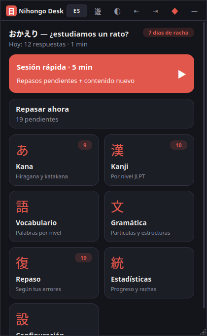
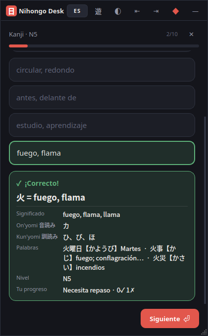
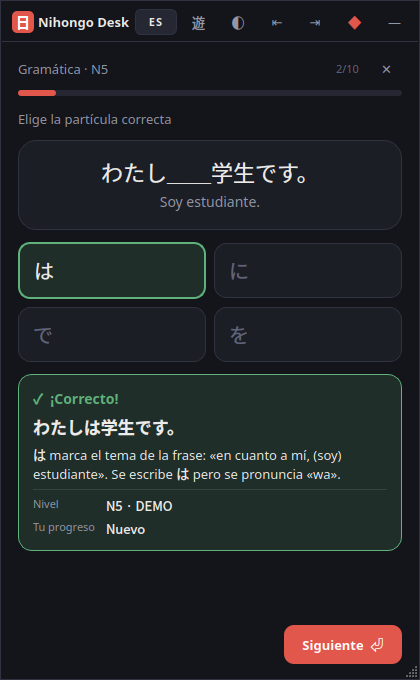
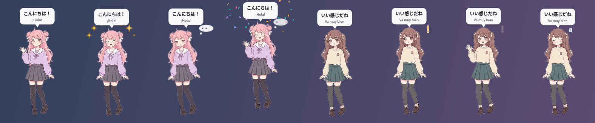

# Nihongo Desk 日

Ventana flotante y compacta para estudiar japonés en sesiones cortas mientras juegas o trabajas: kana, kanji y vocabulario por nivel JLPT y gramática, con repaso espaciado. Funciona sin conexión, sin cuenta y con interfaz en **español o inglés** (botón `ES/EN` en la barra de título).

  

Incluye una **mascota anime opcional** (Momo y Kurumi) que reacciona a tus aciertos y fallos. Puede ir flotando sobre el escritorio o integrada en el panel, y su fondo, tamaño, posición y reacciones son configurables: [docs/MASCOT.md](docs/MASCOT.md).



- Diseño, pantallas y arquitectura: [docs/DESIGN.md](docs/DESIGN.md)
- Mascota: [docs/MASCOT.md](docs/MASCOT.md)
- Origen y licencias del contenido japonés: [docs/DATA_SOURCES.md](docs/DATA_SOURCES.md)

## Descargar y usar (sin instalar Python)

Descarga el archivo de tu sistema desde la página **Releases** del repositorio (o, mientras no haya una versión publicada, desde la última ejecución de **Actions → Build → Artifacts**).

| Sistema | Archivo | Qué hacer |
|---|---|---|
| Windows 10/11 | `NihongoDesk-X.Y.Z-setup.exe` (recomendado) | Doble clic → *Siguiente* → *Instalar*. No pide permisos de administrador. Crea accesos directos en el menú Inicio y, si quieres, en el escritorio y al iniciar Windows. |
| Windows 10/11 | `NihongoDesk-X.Y.Z-windows-portable.zip` | Descomprimir y doble clic en `NihongoDesk.exe`. Sin instalación. |
| Linux (x86_64) | `NihongoDesk-X.Y.Z-x86_64.AppImage` | Clic derecho → *Propiedades* → *Permitir ejecutar* (o `chmod +x`), y doble clic. La primera vez se añade al menú de aplicaciones. |

- **Windows SmartScreen:** como el programa no está firmado, puede aparecer «Windows protegió su PC». Pulsa *Más información* → *Ejecutar de todas formas*.
- **Tus datos se conservan al actualizar:**
  - Para actualizar, instala la versión nueva encima o sustituye el ZIP o el AppImage.
  - El progreso, los ajustes y la mascota se guardan aparte: en `%APPDATA%\NihongoDesk` (Windows) o `~/.local/share/NihongoDesk` (Linux).
  - Ni el instalador ni el desinstalador tocan esa carpeta.
  - Si la app no arranca, el motivo queda anotado en `error.log`, dentro de esa misma carpeta.
- **Linux:**
  - El AppImage ya incluye Python, Qt, la fuente japonesa Noto Sans JP y `libxcb-cursor`.
  - Necesita una distribución de 2022 o posterior (glibc 2.35+: Ubuntu 22.04, Debian 12, Fedora 36…) con escritorio gráfico.
  - Si al abrirlo dice que falta FUSE, ejecútalo con `./NihongoDesk-*.AppImage --appimage-extract-and-run` o instala `fuse3`/`libfuse2`.
  - Para quitarlo del menú de aplicaciones: `./NihongoDesk-*.AppImage --remove-desktop`.

## Ejecutar desde el código (desarrollo)

Requiere Python 3.10 o superior.

**Windows 10**

```bat
py -m venv .venv
.venv\Scripts\pip install -r requirements.txt
run.bat
```

**Linux**

```bash
sudo apt install libxcb-cursor0 fonts-noto-cjk
python3 -m venv .venv && .venv/bin/pip install -r requirements.txt
./run.sh
```

## Generar los instaladores

Los paquetes se generan en `dist/` y cada script los prueba con `--selftest` antes de terminar. Un ejecutable solo se puede generar en su propio sistema: el de Windows en Windows y el de Linux en Linux.

| Plataforma | Comando | Resultado |
|---|---|---|
| Windows | `powershell -ExecutionPolicy Bypass -File packaging\windows\build_windows.ps1` | `-setup.exe` (Inno Setup 6; si no lo tienes, el script intenta instalarlo con winget o choco) y `-windows-portable.zip` |
| Linux | `./packaging/linux/build_appimage.sh` | `-x86_64.AppImage` |
| Las dos, automático | GitHub Actions (`.github/workflows/build.yml`) | Se ejecuta en cada push a `main`. Prueba el instalador (instalar, actualizar y desinstalar sin perder datos), el ZIP portable y el AppImage en Ubuntu 22.04/24.04, Debian 12, Fedora 41 y Arch |

**Publicar una versión nueva:**

1. Cambia `__version__` en `nihongo_desk/__init__.py`, por ejemplo a `0.3.0`.
2. Haz commit y push.
3. Crea y sube la etiqueta:
   ```bash
   git tag v0.3.0
   git push origin v0.3.0
   ```

GitHub Actions compila y prueba los paquetes, y crea una **Release** con el instalador, el ZIP y el AppImage.

## Uso rápido

| Acción | Cómo |
|---|---|
| Mostrar / ocultar | `Ctrl + Shift + J` (configurable) o el icono de la bandeja |
| Responder | clic o teclas `1`–`6`; en preguntas escritas, `Enter` |
| Siguiente pregunta | `Enter` / `Espacio` |
| Salir de la sesión | `Esc` (se guarda y se puede continuar) |
| Escribir japonés | teclea romaji: `gakkou` → がっこう |
| Mover / tamaño compacto | arrastrar / doble clic en la barra de título |
| Acoplar a un lateral | `⇤` `⇥` |
| Mascota | arrastrar para moverla, `Ctrl` + rueda para el tamaño, clic derecho para su menú; se configura en **Mascota (友)** |

**League of Legends:** usa el modo de ventana *Sin bordes* y activa el **modo juego** (`遊`). La app no interactúa con el juego: el atajo usa la API `RegisterHotKey` de Windows y no hay ganchos de teclado.

**Wayland:** las aplicaciones no pueden registrar atajos globales. Crea un atajo del sistema que ejecute `nihongo-desk --toggle` (o `.venv/bin/python -m nihongo_desk --toggle`).

## Desarrollo

```bash
.venv/bin/pytest                                     # pruebas del núcleo
QT_QPA_PLATFORM=offscreen .venv/bin/python tools/screenshots.py   # regenera docs/screens
.venv/bin/python tools/build_content.py              # regenera content.db (ver DATA_SOURCES.md)
.venv/bin/python tools/mascot_art.py                 # regenera las expresiones (requiere numpy, scipy y Pillow)
```

Los datos del usuario se guardan en `%APPDATA%\NihongoDesk` (Windows) o `~/.local/share/NihongoDesk` (Linux). Para usar otra carpeta, define `NIHONGO_DESK_HOME`.
