# Nihongo Desk: diseño y arquitectura

Ventana flotante y compacta para estudiar japonés en sesiones cortas mientras se juega o se trabaja. Se abre y se cierra con un atajo global, funciona sin internet y sin cuenta, y guarda todo en SQLite.

Este documento describe la aplicación **tal y como está implementada** en este repositorio. Sirve de referencia para seguir desarrollándola. Las capturas de `docs/screens/` se generan con `tools/screenshots.py`.

---

## 1. Propuesta visual

**Concepto:** un panel de productividad oscuro y sobrio, con pocos acentos de color tomados de la paleta tradicional japonesa. La referencia japonesa está en los detalles: el logotipo es un sello rojo (hanko) con 日 y cada módulo tiene un kanji como icono. No se usan patrones decorativos.

| Token | Oscuro (por defecto) | Claro | Uso |
|---|---|---|---|
| `bg` | `#14151b` | `#f6f3ee` (和紙 washi) | fondo de la ventana |
| `surface` | `#1c1e26` | `#ffffff` | tarjetas, opciones |
| `accent` | `#e2574c` (朱 shu, bermellón) | `#d4473c` | acción principal, selección, progreso |
| `indigo` | `#7b93ff` (藍 ai) | `#3a5ba0` | foco, selección en «relacionar», avisos DEMO |
| `ok` | `#5fb37a` (抹茶 matcha) | `#3f8f5a` | acierto |
| `bad` | `#e5665b` | `#c9483e` | fallo |

- **Tipografía:** la interfaz usa Segoe UI (Windows) o Noto Sans (Linux). El japonés usa Yu Gothic UI / Meiryo (Windows) o Noto Sans CJK JP (Linux). La fuente japonesa se pide de forma explícita para que los kanji tengan la forma japonesa y no la china (直, 骨…). Ver `ui/theme.py:JP_CANDIDATES`.
- **Formas:** radio de 10–18 px, bordes de 1 px y sin sombras, que son caras en ventanas sin marco.
- **Animaciones** (`ui/widgets.py`): fundido de 160–220 ms al cambiar de pantalla y al mostrar la corrección, sacudida horizontal de la tarjeta cuando se falla y transición de color en las opciones (verde/rojo/atenuado).
- **Tamaños:** 400×640 por defecto, 360×540 en modo compacto y un mínimo de 320×420. Todas las pantallas se han medido para que quepan en 360 px de ancho sin desplazamiento horizontal. La rejilla de módulos pasa de 2 a 4 columnas según el ancho (`FlowGrid`).

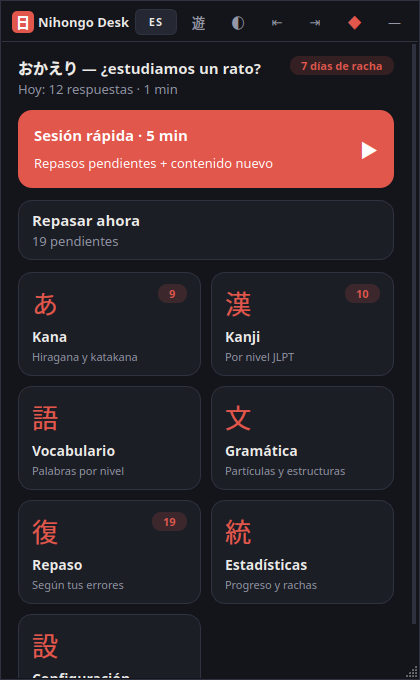 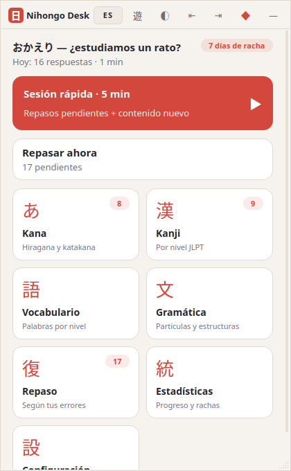

### Barra de título (ventana sin marco)

`←` volver · sello 日 · nombre · **`ES/EN`** (cambia el idioma de la interfaz *y* de los significados) · `遊` modo juego · `◐` tema · `⇤ ⇥` acoplar a la izquierda o a la derecha · `◆/◇` siempre visible · `—` ocultar.

Arrastrar la barra mueve la ventana (`startSystemMove`, compatible con Windows, X11 y Wayland). Un doble clic alterna el tamaño normal y el compacto. La esquina inferior derecha permite redimensionar.

---

## 2. Pantalla principal


De arriba abajo, ordenada según la frecuencia de uso:

1. **Saludo y racha.** Muestra «おかえり», el resumen del día (respuestas y minutos) y una insignia con los días de racha.
2. **Sesión rápida · 5 min** (tarjeta roja, acción principal). Junta los repasos pendientes de los módulos activos y añade contenido nuevo del último módulo usado. La sesión termina al acabarse el tiempo, y no hay nada que configurar.
3. **Continuar sesión.** Aparece solo si se dejó una sesión a medias, que se guarda tras cada respuesta. **Repasar ahora** muestra el número de pendientes.
4. **Rejilla de módulos:** あ Kana · 漢 Kanji · 語 Vocabulario · 文 Gramática · 復 Repaso · 統 Estadísticas · 設 Configuración. Cada tarjeta muestra el número de pendientes de ese módulo.

---

## 3. Selección de kana

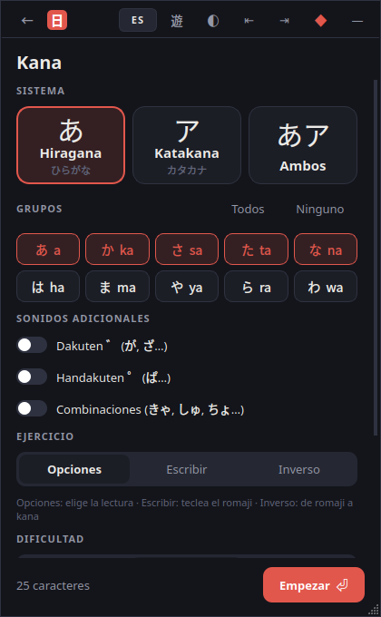

- **Sistema:** tres tarjetas grandes: あ Hiragana · ア Katakana · あア Ambos.
- **Grupos:** chips de las 10 filas (あ a, か ka…), con botones «Todos» y «Ninguno». Las etiquetas cambian según el sistema elegido.
- **Sonidos adicionales:** interruptores para dakuten (が), handakuten (ぱ) y combinaciones (きゃ, しゅ, ちょ).
- **Ejercicio:** Opciones (kana → romaji) · Escribir (teclear el romaji) · Inverso (romaji → elegir el kana).
- **Dificultad** (solo con opciones):
  - Fácil: 3 opciones al azar.
  - Normal: 4 opciones.
  - Difícil: 6 opciones, con prioridad para los caracteres parecidos (ぬ/め, シ/ツ, ソ/ン…; lista en `content/kana.py:CONFUSABLE`).
- **Preguntas:** 10/15/20/30. El interruptor **Solo los que más fallo** usa el historial de errores.
- **Pie fijo:** recuento de caracteres seleccionados y botón **Empezar ⏎**.

**Romanización aceptada:** Hepburn y Kunrei (shi/si, chi/ti, tsu/tu, fu/hu, ji/zi, sha/sya, ja/zya/jya), を = wo/o y ん = n/nn. Las opciones incorrectas nunca comparten lectura con la correcta (じ y ぢ son «ji»).

---

## 4. Selección de nivel JLPT (kanji y vocabulario)

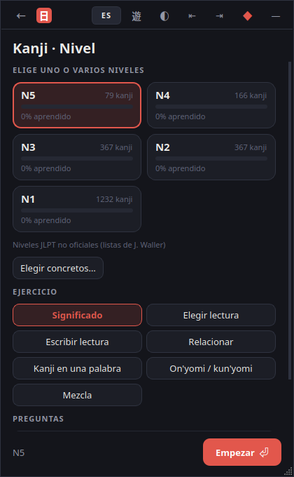 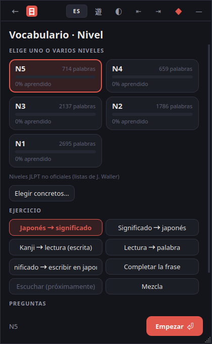

- **Tarjetas N5…N1** de selección múltiple, en dos columnas. Cada una muestra el número de elementos y una barra con el porcentaje aprendido. Elegir varios niveles mezcla su contenido.
- **Aviso:** «Niveles JLPT no oficiales (listas de J. Waller)».
- **Elegir concretos…** abre un diálogo con buscador y casillas para elegir kanji o palabras específicas.
- **Ejercicios de kanji:**
  - Significado.
  - Elegir lectura.
  - Escribir lectura (en hiragana; también se acepta romaji).
  - Relacionar (4 parejas).
  - Kanji en una palabra (〇生 → 学).
  - On'yomi / kun'yomi.
  - Mezcla.
- **Ejercicios de vocabulario:**
  - Japonés → significado.
  - Significado → japonés.
  - Kanji → lectura (escrita).
  - Lectura → palabra.
  - Significado → escribir en japonés.
  - Completar la frase (frase de Tatoeba).
  - Escuchar (*desactivado: próximamente*).
  - Mezcla.
- Kanji y vocabulario son **módulos independientes**: cada uno tiene su configuración, su estado de repaso (`items.module`) y sus estadísticas.

---

## 5. Una sesión real

La pantalla de sesión (`ui/screens/session.py`) es la misma para todos los módulos:

```
┌ Kana · Hiragana                         3/10   ✕ ┐  ← módulo · contador (o ⏱ en la sesión rápida) · salir
│ ▬▬▬▬▬▬▬───────────────────────────────────────── │  ← progreso
│ ¿Cómo se lee?                                    │  ← instrucción
│ ┌──────────────────────────────────────────────┐ │
│ │                (furigana)                    │ │  ← lectura: según la preferencia
│ │                    ぬ                        │ │  ← enunciado grande
│ │                 (pista)                      │ │  ← significado, traducción…
│ └──────────────────────────────────────────────┘ │
│ [ nu ]  [ me ]                                   │  ← opciones (teclas 1–6)
│ [ ne ]  [ re ]                                   │     o campo de texto / parejas / piezas
│ ┌ ✗ Respuesta correcta: ───────────────────────┐ │  ← corrección (aparece al responder)
│ │ ぬ = nu                                      │ │
│ │ Fila なにぬねの. No lo confundas con め (me).│ │
│ │ ───────────────                              │ │
│ │ Significado · Lecturas · Palabras · Nivel ·  │ │  ← ficha ampliada (solo después)
│ │ Tu progreso                                  │ │
│ └──────────────────────────────────────────────┘ │
│ No lo sé                         [Siguiente ⏎]   │
└──────────────────────────────────────────────────┘
```

| Pregunta | Fallo | Acierto (escrito) | Ficha de kanji tras responder |
|---|---|---|---|
| 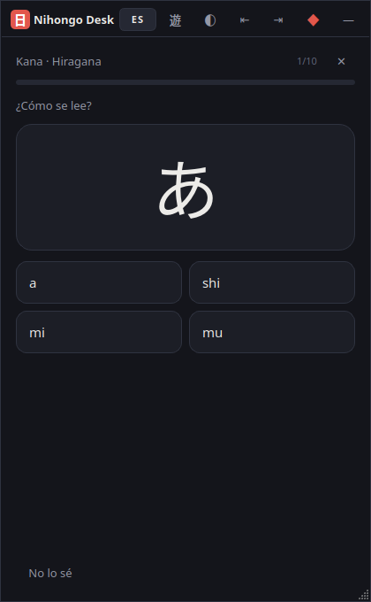 | 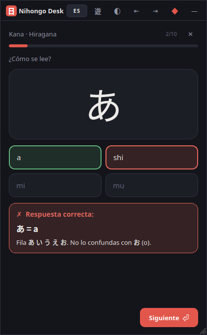 | 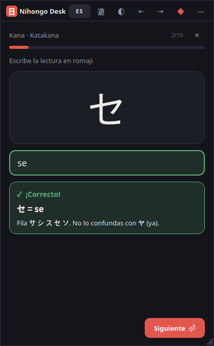 | 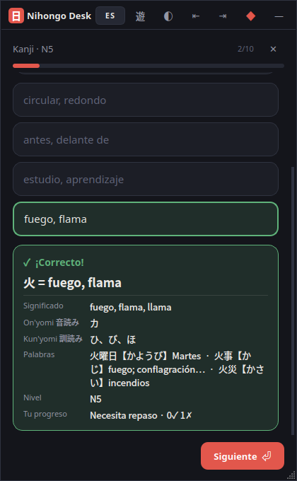 |

**Flujo y teclado**

1. Se muestra la pregunta. En las de opciones, se responde con clic o con las teclas **1–6**. En las escritas, se teclea y se pulsa **Enter**.
2. **Corrección inmediata:**
   - La opción correcta se pone verde, la elegida se pone roja y el resto se atenúa.
   - El campo de texto cambia de color.
   - La tarjeta se sacude si se ha fallado y suena un tono breve (se puede desactivar).
3. **El panel de corrección** muestra la respuesta correcta, una explicación breve y la ficha ampliada:
   - Kanji: significado, on'yomi, kun'yomi, palabras de ejemplo, nivel y progreso personal.
   - Vocabulario: significado, frase de ejemplo, nivel, progreso y, si se activa, romaji.
   - La información adicional **solo se revela después de responder**. El furigana sigue la preferencia «Siempre / Al responder / Nunca».
4. **Enter / Espacio / Siguiente** pasa a la siguiente pregunta. **No lo sé** cuenta como fallo y muestra la respuesta. **Esc** sale: la sesión queda guardada y se puede continuar desde el inicio.
5. **Al terminar** se muestra un resumen con el porcentaje, los aciertos, el tiempo, la lista «Para repasar» y los botones *Otra ronda ⏎* e *Inicio*.

**Escritura en japonés sin IME:** el campo de lectura convierte el romaji a hiragana mientras se escribe (`gakkou` → がっこう, `kanna` → かんな, `ko-hi-` → こーひー). Si hay un IME japonés activo, el kana confirmado se acepta tal cual.

| Escribir lectura | Relacionar | Resumen |
|---|---|---|
| 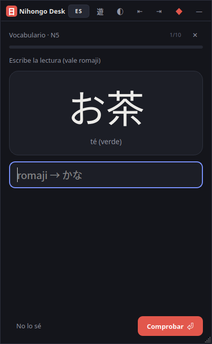 | 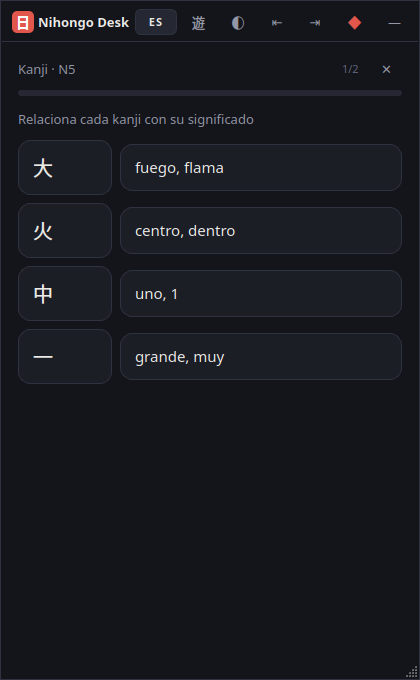 | 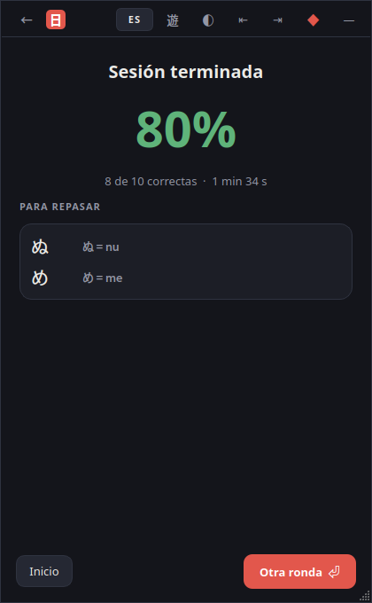 |

---

## 6. Gramática

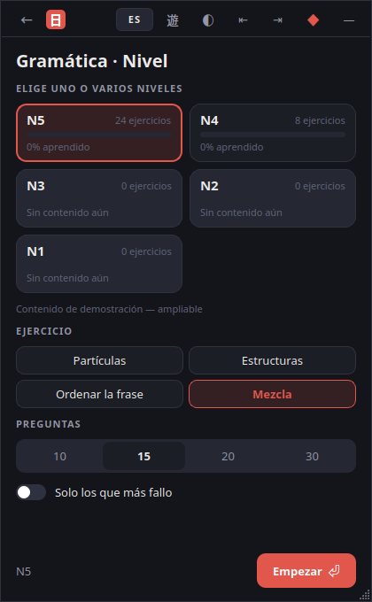 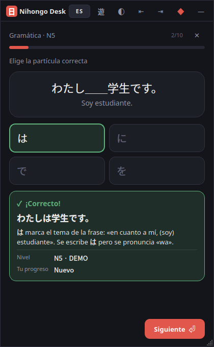 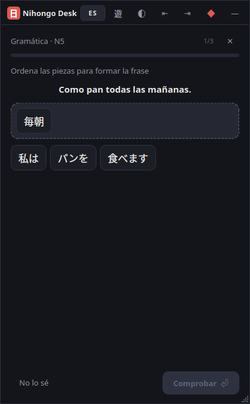

- Selección de nivel N5–N1 con el mismo componente que kanji y vocabulario. Los niveles sin contenido aparecen desactivados («Sin contenido aún») y hay un aviso «Contenido de demostración».
- **Tipos de ejercicio:**
  - **Partículas:** わたし＿＿学生です。 → は / を / に / で.
  - **Estructuras:** elegir la forma correcta, por ejemplo 寒かった frente a 寒いでした.
  - **Ordenar la frase:** se pulsan las piezas para pasarlas a la frase y se pulsan de nuevo para devolverlas. Se aceptan varios órdenes válidos (図書館で友達と… = 友達と図書館で…).
- Tras responder se muestra la frase completa, una explicación breve y la traducción (ES/EN).

---

## 7. Progreso y repasos

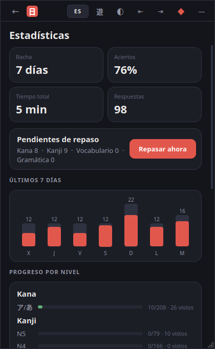

- **Indicadores:** racha, porcentaje de aciertos, tiempo total y número de respuestas.
- **Pendientes de repaso** por módulo, con el botón **Repasar ahora**.
- **Actividad de los últimos 7 días:** el total aparece en gris y los aciertos en rojo.
- **Progreso por módulo y nivel:** aprendidos / total y elementos vistos.
- **Lo que más te cuesta:** elementos ordenados por porcentaje de error.

**Repetición espaciada** (`core/srs.py`, SM-2 simplificado):

| Evento | Efecto |
|---|---|
| 1.er acierto | próximo repaso en 1 día |
| 2.º acierto | 3 días |
| siguientes | intervalo × facilidad (2,5 de partida, +0,05 por acierto, máx. 3,0) |
| fallo | vuelve a aprendizaje: repaso en **10 min**, facilidad −0,2 (mín. 1,3) |
| «aprendido» | intervalo ≥ 7 días · dominio 0–5 derivado del intervalo |

**Orden de una sesión:** primero lo pendiente, después lo que tiene más del 30 % de error, luego lo nuevo y por último el resto al azar (`Engine._prioritize`). *Repasar ahora* reúne lo pendiente de los módulos marcados en Configuración y usa el tipo de ejercicio preferido de cada módulo.

---

## 8. Configuración

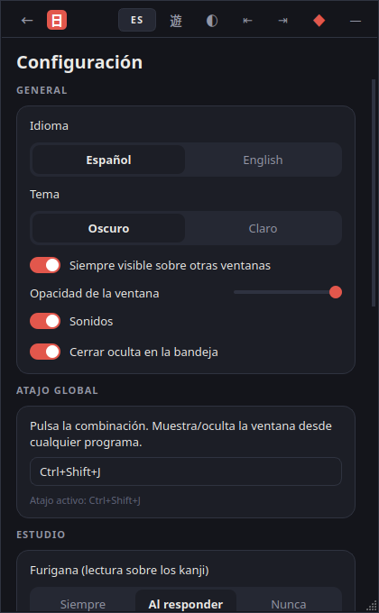

| Sección | Opciones |
|---|---|
| General | idioma (Español/English), tema, siempre visible, opacidad 60–100 %, sonidos, cerrar a la bandeja |
| Atajo global | editor de combinación más estado («Atajo activo», «en uso por otro programa», aviso de Wayland) |
| Estudio | furigana (siempre / al responder / nunca), romaji en vocabulario (al responder / **nunca**, por defecto), romaji en explicaciones de kana, preguntas por sesión, duración de la sesión rápida, módulos incluidos en «Repasar ahora» |
| Modo juego | activar, ocultar al perder el foco, siempre visible en modo juego, tamaño compacto, consejo para LoL |
| Datos | carpeta de datos (botón para abrirla), borrar progreso, fuentes y licencias |

**Todo se guarda al momento:** no hay botón «Guardar».

---

## 9. Navegación

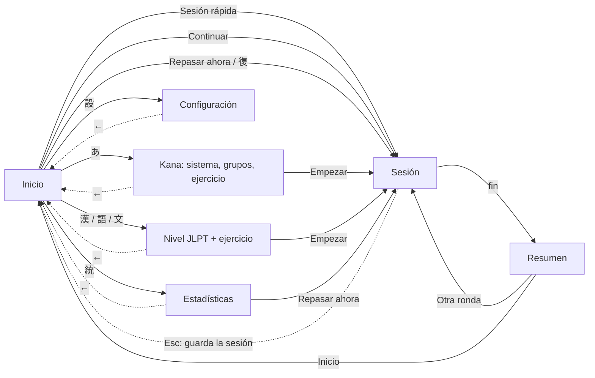

- La navegación tiene como mucho dos niveles: Inicio → configurar → sesión. La flecha `←` siempre vuelve al inicio.
- **Atajos de teclado:** Enter (empezar / comprobar / siguiente), 1–6 (opciones), Esc (salir), y el atajo global (mostrar/ocultar).
- Al cambiar de idioma o de tema se reconstruye la pantalla actual. En una sesión, la pregunta sin responder se regenera en el nuevo idioma.

---

## 10. Arquitectura técnica

```
nihongo_desk/
├── app.py                 arranque, instancia única, --toggle/--quit/--hidden
├── core/
│   ├── paths.py           %APPDATA%\NihongoDesk  |  ~/.local/share/NihongoDesk
│   ├── i18n.py            textos ES/EN, t("clave")
│   ├── srs.py             algoritmo de repaso (puro, sin E/S)
│   └── userdb.py          SQLite del usuario: ajustes, estado SRS, historial
├── content/
│   ├── kana.py            tablas de kana, variantes, parecidos
│   ├── romaji.py          romaji ⇄ kana
│   └── repository.py      lectura de content.db y grammar_demo.json
├── exercises/
│   ├── model.py           Question (independiente de la interfaz) + comprobación
│   ├── engine.py          planificar sesiones (specs) y construir preguntas
│   └── session.py         estado de sesión serializable (continuar más tarde)
├── platform/
│   ├── hotkey.py          RegisterHotKey (Win) / pynput (X11) / aviso (Wayland)
│   └── single_instance.py QLocalServer: segunda ejecución = orden a la primera
├── ui/
│   ├── theme.py           paletas + QSS + elección de fuentes
│   ├── widgets.py         Toggle, Segmented, ChipGroup, KanaLineEdit, BarChart, FlowGrid…
│   ├── sounds.py          tonos generados (sin binarios)
│   ├── main_window.py     ventana sin marco, navegación, bandeja, modo juego, geometría
│   └── screens/           home, kana_setup, level_setup, session, stats, settings
└── resources/             content.db (contenido), grammar_demo.json
```

**Principios**

- **Las capas no se mezclan:** `core`, `content` y `exercises` no importan Qt, así que se prueban con pytest (`tests/test_core.py`). La interfaz solo consume `Question` y `Engine`.
- **Una sesión es una lista de specs** `{"module", "key", "ex"}`. La pregunta concreta se construye justo antes de mostrarla, con opciones incorrectas nuevas cada vez. Por eso la sesión se puede guardar en JSON y continuar, y el cambio de idioma regenera la pregunta.
- **Añadir un módulo nuevo** (por ejemplo, números o audio) requiere cuatro pasos:
  1. Métodos `_plan_<mod>` y `_build_<mod>` en `Engine`.
  2. Una pantalla de configuración en `ui/screens/`.
  3. Una entrada en `home.MODULES`.
  4. Los textos en `i18n.py`.

  El repaso, las estadísticas y la persistencia funcionan sin tocar nada más.
- **Dos bases de datos:** `content.db` es de solo lectura, se distribuye con la app y se regenera con `tools/build_content.py`. `user.db` contiene los datos del usuario y no se mezcla con el contenido, así que actualizar el contenido no borra el progreso.

**Esquema de `user.db`**

```sql
settings(key PRIMARY KEY, value JSON)                       -- ajustes y última sesión
items(module, item_key, level, reps, interval, ease, lapses,
      correct, wrong, last_review, due, PRIMARY KEY(module,item_key))
answers(id, ts, module, item_key, level, exercise, correct, ms)  -- historial y tiempo
```

**Qué se recuerda:**

- Último módulo, niveles y sistema de kana elegidos.
- Tipo de ejercicio y dificultad de cada módulo.
- Geometría de la ventana (la del modo compacto se guarda aparte).
- Atajo, tema, idioma, furigana y romaji.
- Número de preguntas y duración de la sesión rápida.
- Sesión a medias.

El **tiempo de estudio** es la suma del tiempo de respuesta (con un máximo de 60 s por pregunta), así que no cuenta el tiempo en que la ventana está oculta.

### Modo juego y League of Legends

- El atajo global usa `RegisterHotKey` en Windows. Windows **solo** avisa a la app cuando se pulsa esa combinación exacta, sin instalar ganchos de teclado. Así no se leen las pulsaciones del juego, no se le envían entradas y no se toca su proceso ni sus archivos. Si la combinación ya está ocupada, se detecta y se informa.
- **Modo juego:**
  - Sin sonidos ni avisos de la bandeja.
  - Tamaño compacto (360×540), que se deshace al salir.
  - Ocultación automática al volver al juego, es decir, al perder el foco.
  - Opción propia de «siempre visible».
- El LoL debe estar en modo **«Sin bordes»**: en pantalla completa exclusiva ninguna ventana puede dibujarse encima. La app lo recuerda en Configuración.

### Windows 10 y Linux

| Aspecto | Windows 10 | Linux X11 | Linux Wayland |
|---|---|---|---|
| Atajo global | `RegisterHotKey`, detecta conflictos | `pynput` (XRecord), no detecta conflictos | no permitido a las apps → atajo del sistema que ejecute `nihongo-desk --toggle` |
| Siempre visible | sí | sí (depende del gestor de ventanas) | lo decide el compositor |
| Datos | `%APPDATA%\NihongoDesk\user.db` | `~/.local/share/NihongoDesk/user.db` | igual que X11 |
| Fuentes JP | Yu Gothic UI / Meiryo (incluidas en Windows) | `fonts-noto-cjk` | igual |
| Requisitos del sistema | ninguno | `libxcb-cursor0` (Qt ≥ 6.5) | — |

El diseño, las funciones y el formato de datos son idénticos en todas las plataformas.

### Pendiente / siguientes pasos

- **Audio:** pronunciación con TTS local (Windows: voz japonesa del sistema si está instalado el paquete de idioma japonés; Linux: Open JTalk) o archivos de audio con licencia libre. La opción está en la interfaz pero desactivada.
- **Gramática:** revisión nativa del contenido demo y más contenido N4–N1.
- **Traducciones de las frases de ejemplo al español:** Tatoeba tiene pares jpn–spa, pero hay que enlazarlos por ID de frase.
- **IA opcional:** explicar un error o generar ejemplos. Encaja como un proveedor más que añade texto a `Question.explanation`, desactivado por defecto.
- **Pruebas en Windows 10:** atajo global, bandeja, siempre visible y empaquetado con `tools/build_exe.py`. El desarrollo se hizo en Linux (X11).
