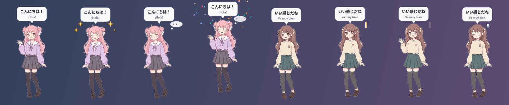
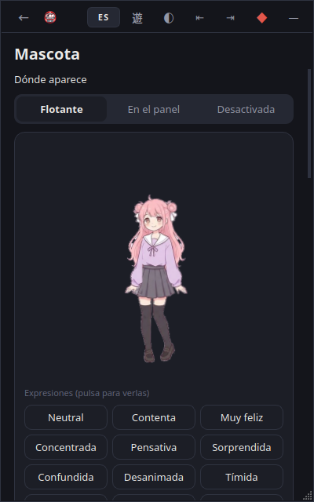
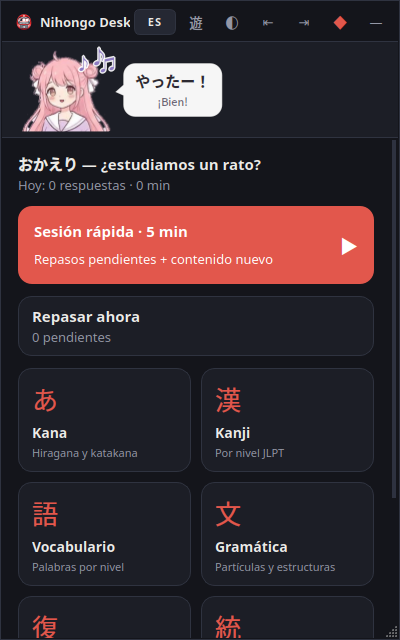

# Mascota virtual

Personaje anime opcional que acompaña el estudio. Puede ir en una **ventana flotante** propia, transparente y sin bordes, o **integrada en el panel**: un busto bajo la barra de título con el bocadillo al lado. Reacciona a lo que pasa en la app y se oculta con un clic, con el atajo global o al activar el modo juego.



 

## Personajes

| | Momo (もも) | Kurumi (くるみ) |
|---|---|---|
| Ilustración base | pelo rosa con moños, uniforme lila | pelo castaño con coletas, jersey crema |
| Personalidad por defecto | alegre y enérgica | tranquila y amable |
| Movimiento | flota más, salta y rebota | flota despacio y asiente |
| Al acertar | sonríe, da un salto y suelta notas ♪ | sonríe y asiente |
| Al fallar | se sorprende un instante y luego te anima | se queda pensativa (…) y luego te anima |
| Frases propias | やったー！, 絶好調！, ファイト！ | いい感じだね, ゆっくりでいいよ |

Además hay dos personalidades más que puedes asignar a cualquier personaje: **tímida** (se sonroja, corazones, frases como す、すごいです…) y **seria** (reposo concentrado, gestos contenidos, 正確です, 復習が大切です). La personalidad cambia las expresiones elegidas, la energía de los movimientos, el ritmo de parpadeo, los efectos y las frases.

## Expresiones

Cada personaje tiene 13 expresiones, más un fotograma de parpadeo para las que tienen los ojos abiertos y uno de habla para las que lo usan (27 imágenes en total):

neutral · contenta · muy feliz · concentrada · pensativa · sorprendida · confundida · desanimada (suave) · tímida · animándote · celebrando · dormida · saludando

Hay dos posturas. La original, con la mano levantada, se usa para saludar, animar y celebrar. Para el resto hay una postura en reposo con los brazos bajados.

**Cómo se hicieron.** Se partió de las dos ilustraciones originales, y todo lo demás son retoques generados por `tools/mascot_art.py`:

1. Se quitó el fondo y el texto «hola».
2. La postura en reposo se creó reflejando el brazo bajado de la propia ilustración.
3. Se retocaron ojos y boca para cada expresión: cerrados, ^ ^, entornados, más abiertos, brillos, boca abierta, «o», ondulada, triste…
4. Se añadieron extras: rubor, gota de sudor y destellos.

No se generó ningún personaje nuevo: en este equipo no había ninguna herramienta de generación de imágenes, así que no fue posible crear poses corporales nuevas.

## Qué funciona y qué mejoraría con más arte

| Funciona ya | Necesitaría ilustraciones nuevas |
|---|---|
| 13 expresiones reconocibles, con parpadeo y habla | Poses corporales distintas: mano en la barbilla, puño arriba, brazos al aire, durmiendo sentada… |
| Flotación, respiración, saltos, asentir, inclinarse y rebotes, sin deformar la imagen | Mirada hacia un lado («pensativa» usa párpados entornados) |
| Fundidos entre expresiones | Animación por capas (pelo, ojos y boca separados) |
| Efectos: ✦, ♥, ♪, confeti, ?, !, …, zZ | Ilustraciones a mayor resolución: el original mide unos 290×490 px, por lo que a tamaños mayores de 380 px se nota algo de suavizado |

**Para mejorar el arte** basta con sustituir los archivos de `assets/characters/<id>/expressions/`, sin tocar el código. Se aceptan PNG o WebP con transparencia y deben seguir estos nombres:

```
neutral  happy  very_happy  focused  thinking  surprised  confused  sad  shy
encouraging  celebrating  sleeping  greeting       (+ _blink y _talk opcionales)
```

## Añadir un personaje

```
nihongo_desk/assets/characters/<id>/
├── manifest.json
└── expressions/neutral.png  (y las demás que tengas)
```

```json
{
  "id": "yuki",
  "name": {"ja": "ゆき", "es": "Yuki", "en": "Yuki"},
  "personality": "serious",
  "accent": "#7aa2d6",
  "bust": [0.08, 0.0, 0.84, 0.31],
  "expressions": "auto"
}
```

- Con un solo `neutral.png` el personaje ya funciona: cada expresión que falte se sustituye por la más parecida (por ejemplo, celebrando → muy feliz → contenta → neutral).
- `bust` es el recorte (x, y, ancho, alto, en proporción) que se usa en el modo integrado.
- Para una personalidad nueva, se añade una entrada en `mascot/personality.py`.

## Personalización (sección «Mascota», icono 友)

- **Dónde aparece:** flotante, en el panel o desactivada.
- **Personaje y personalidad**, con botones para previsualizar cada expresión.
- **Fondo:**
  - Transparente o de color sólido.
  - 8 colores predefinidos, campo hexadecimal y selector RGB.
  - El fondo de la ventana es independiente de la ilustración, que siempre tiene transparencia propia.
- **Tamaño:** de 140 a 520 px, con un deslizador o con `Ctrl` + rueda sobre la mascota.
- **Posición:** las cuatro esquinas o donde la arrastres.
- **Ventana:**
  - Mostrarla u ocultarla.
  - Siempre visible.
  - Ocultarla junto con Nihongo Desk (atajo global).
  - Ocultarla en modo juego.
  - Que los clics la atraviesen. Para volver a interactuar con ella: bandeja → «Mascota: permitir clics».
- **Animación:** animaciones, gestos en reposo y parpadeo.
- **Reacciones:**
  - Aciertos, fallos, celebraciones y saludos.
  - Frases, con traducción opcional.
  - Dormirse tras N minutos sin actividad.
- **Restaurar apariencia predeterminada.**

Todo se aplica al momento y se guarda en `user.db`, en el ajuste `mascot`.

**Sobre la mascota:**

| Gesto | Efecto |
|---|---|
| Clic | Reacciona |
| Doble clic | Abre Nihongo Desk |
| Arrastrar | La mueve |
| Clic derecho | Menú: tamaño, siempre visible, atravesar clics, personalizar, ocultar |

## Comportamiento

- **No roba el foco:** es una ventana `Tool`, con las propiedades `WindowDoesNotAcceptFocus` y `WA_ShowWithoutActivating`. No aparece en la barra de tareas.
- **No consume CPU oculta:** el temporizador de animación (30 fps) se detiene al ocultarse. Mientras se ve, solo repinta su pequeña ventana.
- **Sin sonidos.** Las frases son breves (unos 3,5 s) y poco frecuentes:
  - Hay al menos 25 s de silencio entre frases normales.
  - La probabilidad de hablar depende de la personalidad.
  - Solo el final de sesión y los saludos son seguros.
- **Los errores no se castigan:** tras un fallo siempre termina animando o pensativa. La expresión desanimada solo aparece tras 3 fallos seguidos, de forma breve, y enseguida pasa a animar (lo comprueba una prueba). No hay reacciones a los días sin estudiar.
- **Gestos en reposo:** son poco frecuentes (cada 1–2,5 min), nunca durante una sesión y se pueden desactivar.
- **Transparencia:**
  - En Windows 10 funciona con ventanas por capas, y los píxeles totalmente transparentes dejan pasar los clics.
  - En Linux necesita un compositor. Si el fondo sale negro, elige un color sólido.

## Código

```
nihongo_desk/mascot/
├── character.py    descubre personajes, carga fotogramas, sustituye expresiones que falten
├── personality.py  personalidades: movimiento, reacciones y frases (ja/es/en)
├── animator.py     MascotView: fotogramas, parpadeo, flotación, movimientos, efectos, bocadillo
├── window.py       ventana flotante (sin foco, arrastrable, transparente, atravesable)
├── controller.py   eventos de estudio → reacciones; visibilidad; inactividad; menú
├── config.py       preferencias (por defecto, colores predefinidos, restaurar)
└── strings.py      textos ES/EN
ui/screens/mascot.py   pantalla de personalización
tools/mascot_art.py    genera las expresiones desde la ilustración original
```

El motor de ejercicios no importa nada de la mascota. La app solo llama a `mascot.notify(evento, …)` con estos eventos: `app_started`, `app_shown`, `app_hidden`, `game_mode`, `home`, `session_start`, `answer(ok)` y `session_end(accuracy)`.

Regenerar el arte (solo en desarrollo; requiere `numpy`, `scipy` y `Pillow`):

```bash
pip install numpy scipy pillow
python tools/mascot_art.py --sheet hoja.png
```
